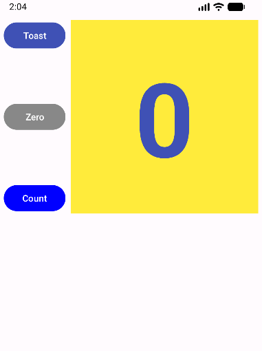
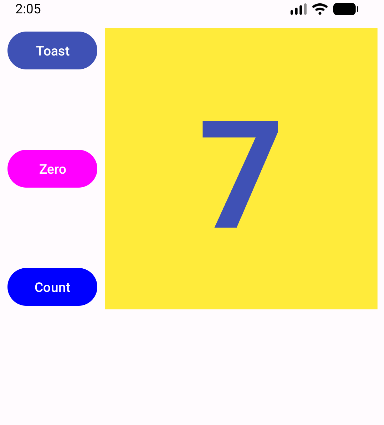
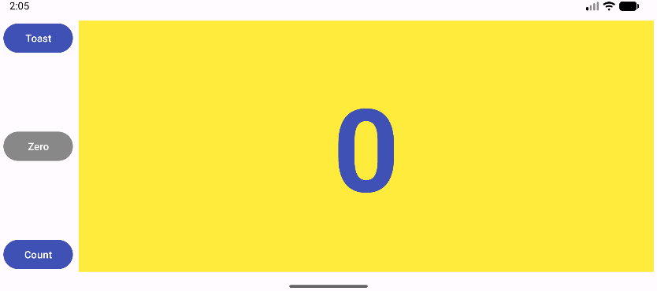

# Naloga 3 – HelloConstraint

Šolska naloga pri predmetu **Razvoj mobilnih aplikacij (Naloga 3)**.
Android aplikacija v jeziku **Java**, ki prikazuje delo z omejitvami v `ConstraintLayout`, obdelavo dogodkov klika in postavitve za različne orientacije in velikosti zaslona.

## Opis

Aplikacija vsebuje tri gumbe (**Toast**, **Zero**, **Count**) levo od rumenega prikaza `show_count`:

- **Toast** prikaže sporočilo `Toast`.
- **Count** poveča števec za 1 in na prikazu izpiše novo vrednost. Barva gumba je zelena pri sodi in modra pri lihi vrednosti. Hkrati gumb **Zero** postane roza (aktiven).
- **Zero** ponastavi števec na 0 in gumb vrne na sivo barvo.

Gumbi so navpično razporejeni med zgornji in spodnji rob prikaza `show_count`. Postavitve so pripravljene za portret (`layout`), ležeče (`layout-land`) in tablice (`layout-xlarge`).

## Zaslonske slike

**Začetni prikaz (Zero je siv)**

**Po klikih na Count (portret)**

**Ležeča postavitev**

## Struktura projekta

| Datoteka | Opis |
|---|---|
| `app/src/main/java/.../MainActivity.java` | obdelava klikov (showToast, countUp, zeroCount) |
| `app/src/main/res/layout/activity_main.xml` | postavitev za portret |
| `app/src/main/res/layout-land/activity_main.xml` | postavitev za ležečo orientacijo |
| `app/src/main/res/layout-xlarge/activity_main.xml` | postavitev za večji zaslon (tablica) |
| `app/src/main/res/values/strings.xml` | besedilni viri |

## Namestitev na telefon

Datoteka `app-debug.apk` je na voljo v razdelku **Releases** tega repozitorija.

1. Prenesi `app-debug.apk` na telefon.
2. Odpri datoteko in dovoli namestitev iz neznanih virov.
3. Tapni **Install** in nato **Open**.

## Avtor

Nejc Bajda – ŠC Nova Gorica, Elektrotehniška in računalniška šola
